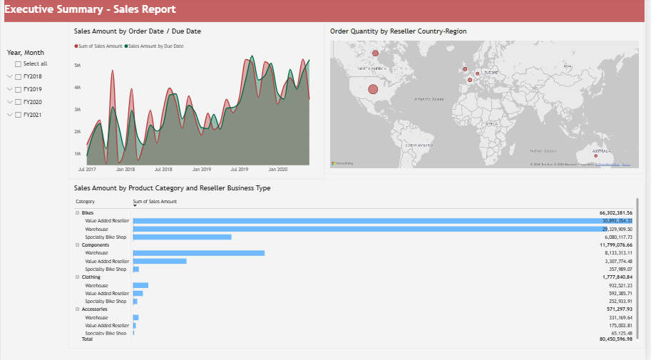

# AdventureWorks Sales Executive Report

An interactive **Power BI sales report** built using the AdventureWorks sample dataset. The project analyzes sales performance across time, geography, product categories, and reseller business types.

The report is designed as an **executive sales report** that helps management understand sales performance and identify areas that deserve continued investment.

> **Note:** This project is based on the Microsoft Learn AdventureWorks Power BI dimensional-model tutorial, with the report developed and documented as a portfolio project.

---

## 📊 Report Preview



---

## 📌 Project Overview

AdventureWorks is a fictional bicycle manufacturer that sells bicycles and accessories to customers and resellers across different geographic regions.

The goal of this project is to transform the AdventureWorks sales data into an interactive Power BI report that answers key business questions and provides an easy-to-use executive overview.

The project demonstrates:

- Data preparation using Power Query
- Dimensional/star-schema data modeling
- Table relationships
- Hierarchies
- DAX measures
- Interactive Power BI visuals
- Slicers and filtering
- Sales performance analysis
- Geographic analysis
- Product and reseller analysis

---

## 🎯 Business Questions

The report focuses on the following questions:

1. **Which day had the most sales in February 2019?**
2. **Which country/region is the company seeing the most success in?**
3. **Which product category and reseller business types should the company continue to invest in?**

Additional analysis supported by the report includes:

- How does sales performance change over time?
- Which product categories generate the most sales?
- Which reseller business types contribute the most sales?
- How does sales performance vary geographically?

---

## 🛠️ Tools & Technologies

| Tool | Purpose |
|---|---|
| **Power BI Desktop** | Data modeling, DAX, visualization and report development |
| **Power Query** | Data preparation and transformation |
| **DAX** | Measures and calculations |
| **Excel** | Source dataset |
| **Git/GitHub** | Project version control and portfolio hosting |

---

## 📁 Project Structure

```text
AdventureWorks-PowerBI/
│
├── power_bi/
│   └── AdventureWorks_Sales.pbix
│
├── screenshots/
│   └── report.png
│
├── data/
│   └── README.md
│
└── README.md
```

### Files and folders

#### `power_bi/`

Contains the completed Power BI report.

```text
power_bi/AdventureWorks_Sales.pbix
```

The `.pbix` file contains:

- Data model
- Relationships
- Hierarchies
- DAX measures
- Report visuals
- Slicers
- Report formatting

#### `screenshots/`

Contains screenshots of the completed Power BI report.

```text
screenshots/report.png
```

#### `data/`

Contains documentation about the dataset and instructions for obtaining the source data.

```text
data/README.md
```

The raw Excel dataset is not included in this repository unless its redistribution terms permit it.

---

## 🧩 Data Model

The project uses a dimensional/star-schema approach.

The central **Sales** fact table contains transactional sales information, while surrounding dimension tables provide descriptive context.

### Main tables

- Customer
- Date
- Product
- Reseller
- Sales
- Sales Order
- Sales Territory

### Model concept

```text
                  Customer
                     │
                     │
Product ────────── Sales ────────── Reseller
                     │
                     │
                    Date
                     │
                     │
              Sales Territory
                     │
                Sales Order
```

The actual relationships and cardinalities are defined within the Power BI model.

---

## 🏗️ Data Preparation

The dataset was loaded into Power BI and prepared using Power Query.

Key preparation steps included:

1. Importing the AdventureWorks Excel workbook.
2. Loading the required tables.
3. Reviewing column data types.
4. Setting appropriate numeric, date, decimal and percentage data types.
5. Creating relationships between fact and dimension tables.
6. Hiding technical key columns from the report view.
7. Creating user-friendly hierarchies.
8. Preparing the model for reporting.

Examples of important data types include:

- Keys → Whole Number
- Dates → Date
- Sales Amount → Decimal Number
- Unit Price → Decimal Number
- Discount Percentage → Percentage
- Order Quantity → Whole Number

---

## 🗂️ Hierarchies

Hierarchies were created to make navigation and drill-down analysis easier.

### Customer — Geography

```text
Country-Region
    └── State-Province
        └── City
            └── Postal Code
                └── Customer
```

### Date — Fiscal

```text
Year
    └── Quarter
        └── Month
            └── Date
```

### Product — Products

```text
Category
    └── Subcategory
        └── Model
            └── Product
```

### Reseller — Geography

```text
Country-Region
    └── State-Province
        └── City
            └── Postal Code
                └── Reseller
```

### Sales Order — Sales Orders

```text
Sales Order
    └── Sales Order Line
```

### Sales Territory — Sales Territories

```text
Group
    └── Country-Region
        └── Region
```

These hierarchies allow users to move between high-level and detailed views of the data.

---

## 📐 DAX

The project primarily uses Power BI's built-in aggregation capabilities, with DAX used where a custom calculation is required.

One example is calculating sales using the **Due Date** relationship rather than the default Order Date relationship.

```DAX
Sales Amount by Due Date =
CALCULATE(
    SUM(Sales[Sales Amount]),
    USERELATIONSHIP(
        Sales[DueDateKey],
        'Date'[DateKey]
    )
)
```

This measure activates the inactive relationship between the Sales table's `DueDateKey` and the Date table's `DateKey` for the calculation.

---

## 📊 Report

The main report is designed as an **Executive Summary – Sales Report**.

### 1. Sales Amount by Date

An area chart is used to analyze sales over time.

It allows the user to identify periods with particularly high or low sales and investigate sales performance at different time levels.

The report can use the Fiscal hierarchy to drill through:

```text
Year → Quarter → Month → Date
```

### 2. Order Quantity by Country/Region

A geographic visual is used to compare order quantities across countries/regions.

This provides a high-level view of where AdventureWorks is generating the greatest order volume.

### 3. Sales Amount by Product Category and Reseller Business Type

A matrix is used to compare sales across:

- Product Category
- Reseller Business Type

Conditional formatting/data bars make differences in sales performance easier to identify.

This helps management identify product categories and reseller segments that contribute most strongly to sales.

### 4. Fiscal Year/Month Slicer

A slicer allows users to filter the report by fiscal period.

This makes it possible to analyze specific years or months without changing the underlying visuals.

---

## 💡 Key Insights

The Microsoft tutorial uses the AdventureWorks dataset to answer the following questions.

### Highest sales day in February 2019

The highest sales day in February 2019 is:

**February 25, 2019**

Reported sales:

**$253,915.47**

### Highest-performing country/region

The **United States** has the highest order quantity in the tutorial's analysis.

Reported order quantity:

**132,748**

### Product and reseller investment

**Bikes** represent the strongest product category in the analysis.

Within reseller business types, **Value Added Resellers** and **Warehouses** are important contributors to sales.

These results suggest that management should continue paying particular attention to the bicycle category and these reseller segments.

> These figures are based on the AdventureWorks sample report and should be treated as findings from the sample dataset rather than real-world business information.

---

## 📈 Portfolio Skills Demonstrated

### Power BI

- Report development
- Visual selection
- Report layout
- Slicers
- Drill-down
- Interactive filtering
- Conditional formatting

### Data Modeling

- Star schema
- Fact tables
- Dimension tables
- One-to-many relationships
- Active and inactive relationships
- Hierarchies
- Hiding technical key columns

### Power Query

- Data loading
- Data type management
- Data preparation
- Query transformation

### DAX

- `SUM`
- `CALCULATE`
- `USERELATIONSHIP`
- Measure creation

### Business Analysis

- Sales trend analysis
- Geographic performance
- Product performance
- Reseller performance
- Executive reporting

---

## 🔗 Dataset & References

### Microsoft Learn Tutorial

[From dimensional model to stunning report in Power BI Desktop](https://learn.microsoft.com/en-us/power-bi/create-reports/desktop-dimensional-model-report)

### AdventureWorks Sample Data

[AdventureWorks Sample Databases — Microsoft Learn](https://learn.microsoft.com/en-us/sql/samples/adventureworks-install-configure)

### Microsoft Power BI Desktop Samples

[Power BI Desktop Samples — AdventureWorks](https://github.com/microsoft/powerbi-desktop-samples/tree/main/DAX)

---

## 🚀 How to Use the Project

### 1. Install Power BI Desktop

Download and install Power BI Desktop from Microsoft.

### 2. Obtain the dataset

Follow the instructions in:

```text
data/README.md
```

to obtain the AdventureWorks dataset.

### 3. Open the Power BI report

Open:

```text
power_bi/AdventureWorks_Sales.pbix
```

in Power BI Desktop.

### 4. Explore the report

Use the slicers and visual interactions to explore:

- Sales over time
- Geographic performance
- Product performance
- Reseller performance

### 5. Refresh the data

If the source data has been moved or replaced, update the relevant data source settings in Power BI before refreshing the report.

---

## 📌 Limitations

- AdventureWorks is a fictional/sample business dataset.
- The report is intended for learning and portfolio purposes.
- Business conclusions are based only on the available sample data.
- The report does not represent real AdventureWorks business performance.
- Dataset availability and download locations may change over time.

---

## 📄 License & Dataset Attribution

The AdventureWorks data is provided by Microsoft as sample data for learning and development.

Please refer to the original Microsoft documentation and dataset repository for the applicable licensing and usage terms.

This repository contains my Power BI report and project documentation and does not claim ownership of the original AdventureWorks dataset.

---

## 👤 Author

**Lijo John Daniel**

Data Analytics Portfolio Project

**Focus:** Data Analytics • Power BI • SQL • Python

---

## ⭐ Project Purpose

This project was created as part of my Data Analytics portfolio to demonstrate practical skills in:

**Data Preparation → Data Modeling → DAX → Visualization → Business Analysis**

The objective is to demonstrate the ability to turn structured business data into an interactive report that can support business decision-making.